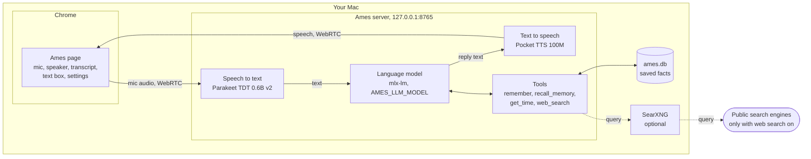
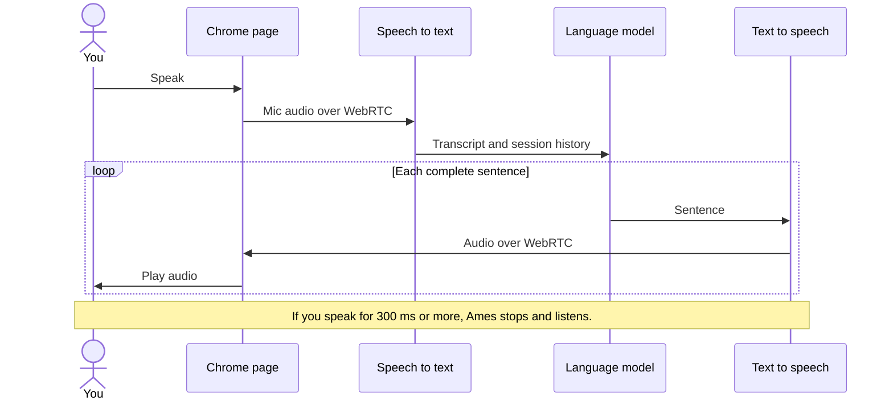

# Ames

Ames is a private voice agent. You talk to it in Chrome, and it talks back. Every model runs on your own Mac. Use it to talk through ideas and to do general research.

## Status

The live voice loop works end to end. These parts are built:

- Speech to text, a local language model, and text to speech, connected over WebRTC.
- A female voice and a male voice. You select one in the page.
- A text box. A typed message stops the current reply, and Ames speaks the answer.
- Tools that the model can call:
  - `remember` and `recall_memory` keep short facts in a local SQLite database. The page lists the facts and lets you delete them.
  - `get_time` reads the local clock.
  - `web_search` is off by default. You turn it on in the page.

These parts are planned for v1 and are not built yet:

- Automatic extraction of facts from the conversation.
- Automatic retrieval of facts into the prompt.
- Summaries of long conversations.

Conversation history stays in server memory for the current session only.

## Privacy

- The server listens only on `127.0.0.1`. No other computer can connect to it.
- Audio and transcripts do not leave your Mac.
- The server does not download models. You put them on disk yourself (see [server/README.md](server/README.md)).
- Web search is the only feature that sends data out. It is off by default. When you turn it on, each search query goes to a SearXNG server (default `http://localhost:8080`). SearXNG sends the query to public search engines. If `BRAVE_API_KEY` is set and SearXNG fails, the query goes to the Brave Search API.

## How it works

The browser sends microphone audio to the server. The server turns speech into text, writes a reply with the language model, and turns the reply into speech. The browser plays the speech.



One spoken turn goes through these steps:



Ames starts to speak after the first complete sentence. The model continues to write the next sentences at the same time.

## Requirements

- An Apple Silicon Mac with 24 GB of RAM or more. The reference machine is an M4 Pro with 24 GB.
- The text-to-speech real-time factor at startup must be 0.9 or less. If the Mac is too slow, the server stops. There is no fallback voice.
- Python 3.12 and [uv](https://docs.astral.sh/uv/).
- Node 22.18 or a later Node 22 release.
- Chrome.

Stub mode (`AMES_STUB=1`) needs no models and no special hardware. CI uses stub mode on Ubuntu.

## Build and test

Run these commands from the repository root:

```sh
uv sync --locked
AMES_STUB=1 uv run --locked pytest -q
uv run --locked ruff check server
uv run --locked ruff format --check server
cd web
npm ci
npm run lint
npm test
npm run build
```

## Run in stub mode

Stub mode uses a fixed transcript, a fixed reply, and a tone in place of speech.

1. Build the web client (see the previous section).
2. From the repository root, run:

   ```sh
   AMES_STUB=1 uv run --locked python -m server.app
   ```

3. The server opens Chrome. The URL contains a private token after the `#`.
4. Accept the first-run advisory.
5. Select **Start conversation**. Chrome asks for the microphone.
6. Speak, or type in the text box. You hear the stub reply as a tone.

## Run with real models

1. Install the local models. The steps are in [server/README.md](server/README.md#recorded-cascade-and-latency).
2. Set `AMES_LLM_MODEL` to an mlx-lm model directory. The server does not start without it. There is no default.
3. Run:

   ```sh
   AMES_STUB=0 AMES_LLM_MODEL="$HOME/Library/Application Support/Ames/models/qwen3.5-2b-ames-v1.2-mlx-4bit" \
     uv run --locked --extra mac python -m server.app
   ```

The recommended model is the Qwen3.5 2B Ames fine-tune v1.2, MLX 4-bit. You can use a different local mlx-lm model directory.

## Repository layout

| Path | Contents |
|---|---|
| [server/](server/README.md) | Python server: HTTP app, voice pipeline, tools, memory store |
| [web/](web/README.md) | Browser client: TypeScript and Vite |
| [persona/](persona/ames.md) | Character sheet and system prompt |
| [evals/](evals/README.md) | Frozen eval sets and the eval runner |
| [docs/design.md](docs/design.md) | v1 design |
| [docs/architecture/](docs/architecture/README.md) | C4 architecture diagrams |
| [docs/roadmap.md](docs/roadmap.md) | Work after v1 |
| [AGENTS.md](AGENTS.md) | Rules for contributors and coding agents |

## License

Apache License 2.0. See [LICENSE](LICENSE).
