# C4 level 3: voice pipeline components

The live pipeline inside the server, in the order frames flow. Source: `server/live.py` (`build_live`, `live_stages`), `server/cascade.py` (`cascade_stages`), `server/prompt.py`, `server/control_tokens.py`, `server/events.py`.

```mermaid
flowchart LR
    browser["<b>Web client</b><br/>[Container]<br/>Mic and speaker"]

    subgraph pipe["Voice pipeline [Pipecat pipeline, one per session]"]
        tin["<b>Transport input</b><br/>[SmallWebRTCTransport]<br/>Receives mic audio, 16 kHz"]
        vad["<b>VAD and turn start</b><br/>[Silero VAD, VADUserTurnStartStrategy]<br/>Speech of at least 300 ms starts a turn and interrupts"]
        stt["<b>STT</b><br/>[ParakeetSTTService, MLX]<br/>Transcribes each VAD segment"]
        prompt["<b>Prompt assembly</b><br/>[SessionPrompt, PromptAssembler]<br/>Persona, last 3000 history tokens, new user turn"]
        llm["<b>LLM</b><br/>[LocalLLMService, mlx-lm]<br/>Streams tokens, cancelled on interruption"]
        san["<b>Control-token sanitizer</b><br/>[ReplySanitizer, parse_chunk]<br/>Strips state token and inline tags, reads mood"]
        split["<b>Sentence splitter</b><br/>[SentenceSplitter, SimpleTextAggregator]<br/>Emits complete sentences"]
        tts["<b>TTS</b><br/>[QwenTTSService, MLX]<br/>Per-mood instruction, 24 kHz PCM, streaming"]
        tout["<b>Transport output</b><br/>[SmallWebRTCTransport]<br/>Sends Ames audio"]
        rec["<b>Session output</b><br/>[SessionOutput]<br/>Records sentences after they are sent, speaking events"]
    end

    events["<b>Session events</b><br/>[Events, RTVI server messages]<br/>transcript, speaking, state, notice"]
    hist[("<b>Session history</b><br/>[In-process list]")]

    browser -->|"Mic audio<br/>[WebRTC]"| tin
    tin -->|"Audio frames"| vad
    vad -->|"Speech segments"| stt
    stt -->|"Transcript text"| prompt
    prompt -->|"Message list"| llm
    llm -->|"Text chunks"| san
    san -->|"Spoken text"| split
    split -->|"Sentences"| tts
    tts -->|"PCM audio"| tout
    tout -->|"Ames audio<br/>[WebRTC]"| browser
    tout -->|"Sent-sentence receipts"| rec

    prompt -->|"Reads turns, adds user turn"| hist
    rec -->|"Adds played sentences"| hist
    prompt -->|"user transcript, speaking"| events
    san -->|"mood state"| events
    rec -->|"ames transcript, speaking"| events
    events -->|"[RTVI over WebRTC data channel]"| browser

    classDef comp fill:#85bbf0,stroke:#5d82a8,color:#000000
    classDef ext fill:#438dd5,stroke:#2e6295,color:#ffffff
    class tin,vad,stt,prompt,llm,san,split,tts,tout,rec,events comp
    class browser,hist ext
```

Notes:

- A reply is split into sentences before TTS, so speech starts at the first complete sentence while the LLM keeps generating.
- History gets only sentences whose audio the transport has sent. A cut sentence and queued sentences are dropped on interruption.
- On interruption (`InterruptionFrame`) the LLM generation is cancelled and queued TTS is dropped.
- `crisis=1` replies currently produce no TTS text. The full crisis exit is slice S6 and is not drawn.
- The memory retrieval slot in prompt assembly exists in code but receives an empty late block in v1.
