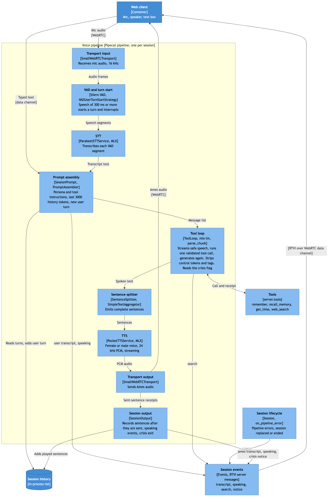
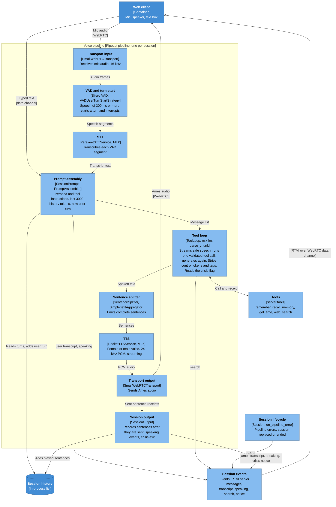

# C4 level 3: voice pipeline components

This diagram shows the live pipeline inside the server, in the order that frames go through it. Source: `server/live.py` (`build_live`, `live_stages`, `ToolLoop`), `server/cascade.py` (`cascade_stages`), `server/prompt.py`, `server/control_tokens.py`, `server/tools.py`, `server/events.py`.

The Mermaid source below is the source of truth. The PNG is a render of it.

Notes:

- The pipeline splits a reply into sentences before TTS. Speech starts at the first complete sentence while the LLM continues to generate.
- History gets only sentences whose audio the transport has sent. On interruption, the pipeline drops a cut sentence and queued sentences.
- On interruption (`InterruptionFrame`), the pipeline cancels LLM generation and drops queued TTS.
- Typed text enters the same way as barge-in: an `InterruptionFrame` stops any reply, then the text starts a turn. The diagram draws it into prompt assembly for clarity.
- `Conversation` derives the `speaking` event one time from two flags (user speaking, Ames speaking). Thus a late bot stop during barge-in cannot hide the user.
- When a reply has `crisis=1`, the tool loop speaks a fixed crisis line in place of the reply. After the line plays, session output sends `session_ended` and closes the connection.
- Notices come from the session lifecycle (the pipeline error handler in `server/live.py`, session close and replace in `server/app.py`), not from a pipeline stage.
- The HTTP app sends the first `speaking: none` event when it accepts the offer (`server/app.py`), before the pipeline runs.
- Prompt assembly has a slot for memory retrieval, but it gets an empty late block until automatic retrieval is built.
