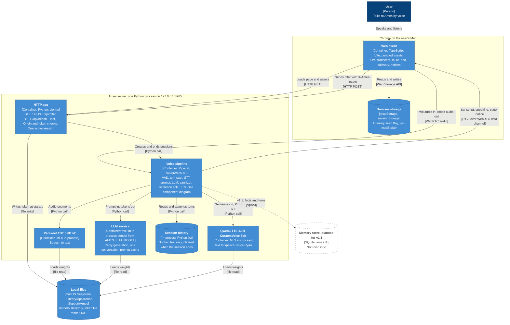

# C4 level 2: containers

Ames v1 is a browser client plus one Python server process. The three models run inside that process on MLX, so they are shown as in-process modules, not as separate services. Source: `docs/design.md` sections 5 and 9, `server/app.py`, `server/README.md`.

Notes:

- The memory store is drawn dashed and white because it is planned for v1.1. The schema and repository exist in `server/memory/` but nothing in v1 opens them.
- The token file is written by the server when it starts. Chrome gets the token in the URL fragment, which never reaches the server.
- Conversation text is never written to disk in v1.
