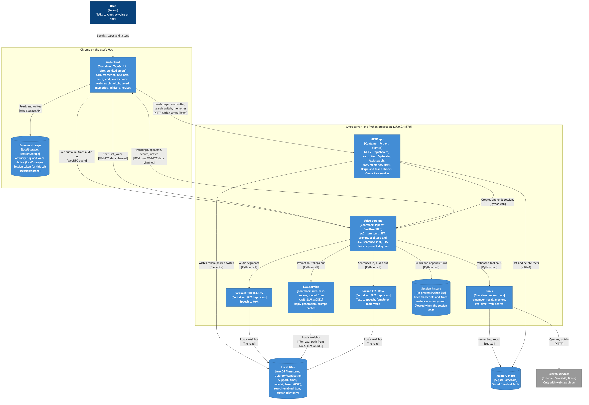
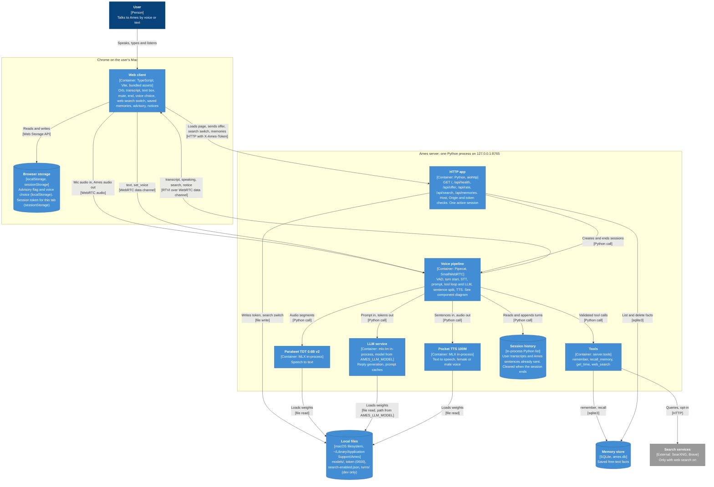

# C4 level 2: containers

Ames v1 is a browser client and one Python server process. The three models run inside that process on MLX, so the diagram shows them as in-process modules, not as separate services. Source: `docs/design.md` sections 5 and 9, `server/app.py`, `server/tools.py`, `server/README.md`.

The Mermaid source below is the source of truth. The PNG is a render of it.

Notes:

- The memory store holds facts that the model saves with the `remember` tool. The page lists and deletes them through `/api/memories`. Automatic extraction and retrieval into the prompt are planned for v1 and are not built yet.
- The server writes the token file when it starts. Chrome gets the token in the URL fragment, which never goes to the server.
- The server writes conversation text to disk only in two cases: facts that the model saves, and the dev-only turn log (`AMES_TURN_LOG=1`).
