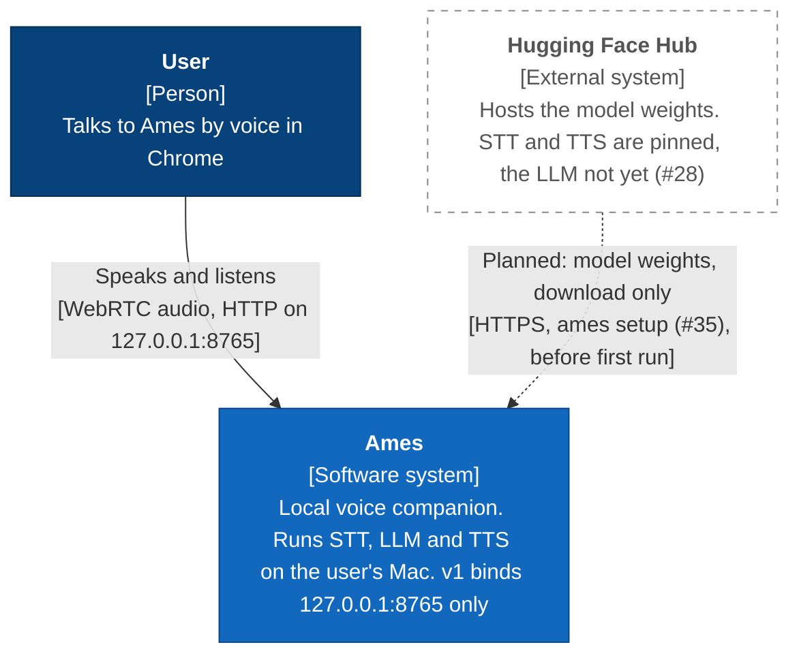

# C4 level 1: system context

Ames is a local voice companion. One person talks to it in Chrome on their own Apple Silicon Mac, and every model runs on that Mac. Source: `docs/design.md` sections 1, 3 and 9.3.

The Mermaid source below is the source of truth; the PNG is a render of it.

Notes:

- The dashed arrow and Hugging Face box are planned: `ames setup` (#35) is not built yet, and today the models are placed by hand (see `server/README.md`). Once built, it is the only network use. After the models are on disk the server sets `HF_HUB_OFFLINE=1` and makes no network calls, and WebRTC uses an empty `iceServers` list.
- Memory across sessions (SQLite, design section 6) is planned for v1 and not built yet, so it is not in this diagram. Until it is built, history stays in server memory for the session only.
