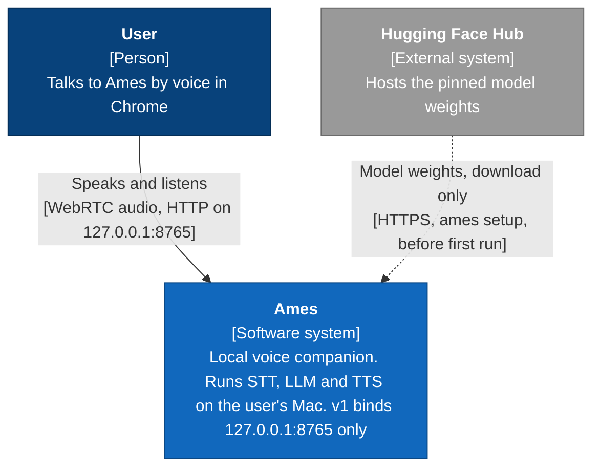

# C4 level 1: system context

Ames is a local voice companion. One person talks to it in Chrome on their own Apple Silicon Mac, and every model runs on that Mac. Source: `docs/design.md` sections 1, 3 and 9.3.

Notes:

- The dashed arrow happens only during `ames setup`. After the models are on disk the server sets `HF_HUB_OFFLINE=1` and makes no network calls, and WebRTC uses an empty `iceServers` list.
- `ames setup` (#35) is not built yet. Today the models are placed by hand (see `server/README.md`).
- Memory across sessions (SQLite, design section 6) is planned for v1.1 and is not part of the v1 context diagram. v1 keeps history in server memory for the session only.
