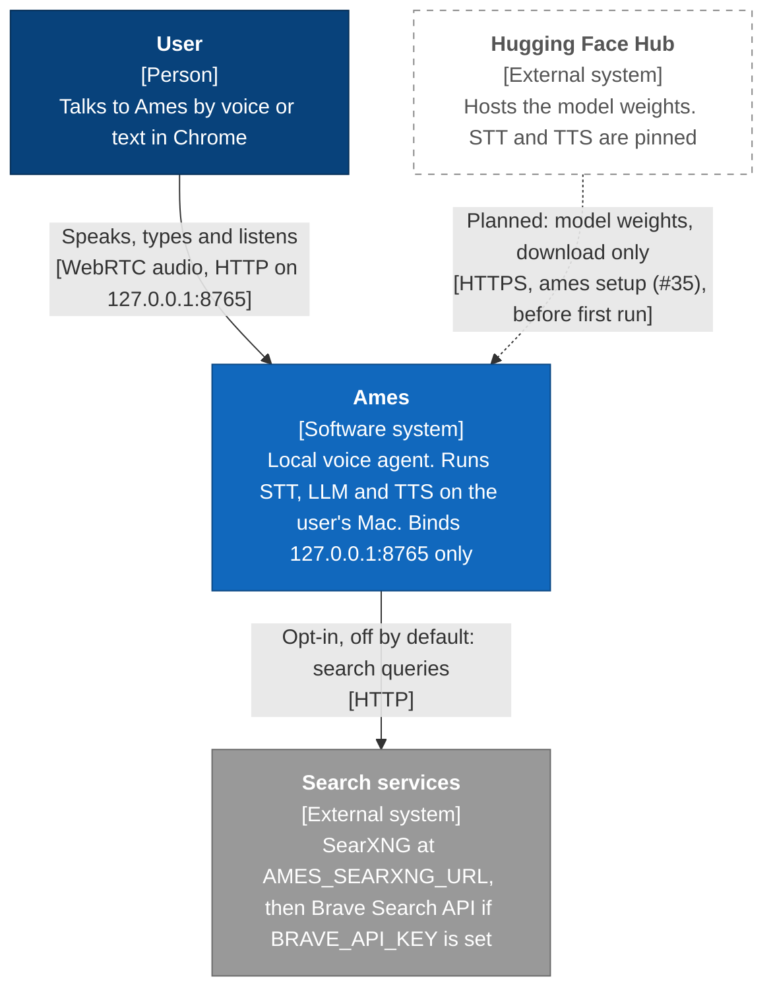

# C4 level 1: system context

Ames is a local voice agent. One person talks to it in Chrome on their own Apple Silicon Mac. Every model runs on that Mac. Source: `docs/design.md` sections 1, 3, and 9.3, and `server/tools.py`.

The Mermaid source below is the source of truth. The PNG is a render of it.

Notes:

- Web search is the only runtime network use. It is off by default. The user turns it on in the page. SearXNG sends each query to public search engines.
- The dashed arrow and the Hugging Face box are planned. `ames setup` (#35) is not built yet. Today you put the models in place yourself (see `server/README.md`).
- After the models are on disk, the server sets `HF_HUB_OFFLINE=1`. WebRTC uses an empty `iceServers` list.
