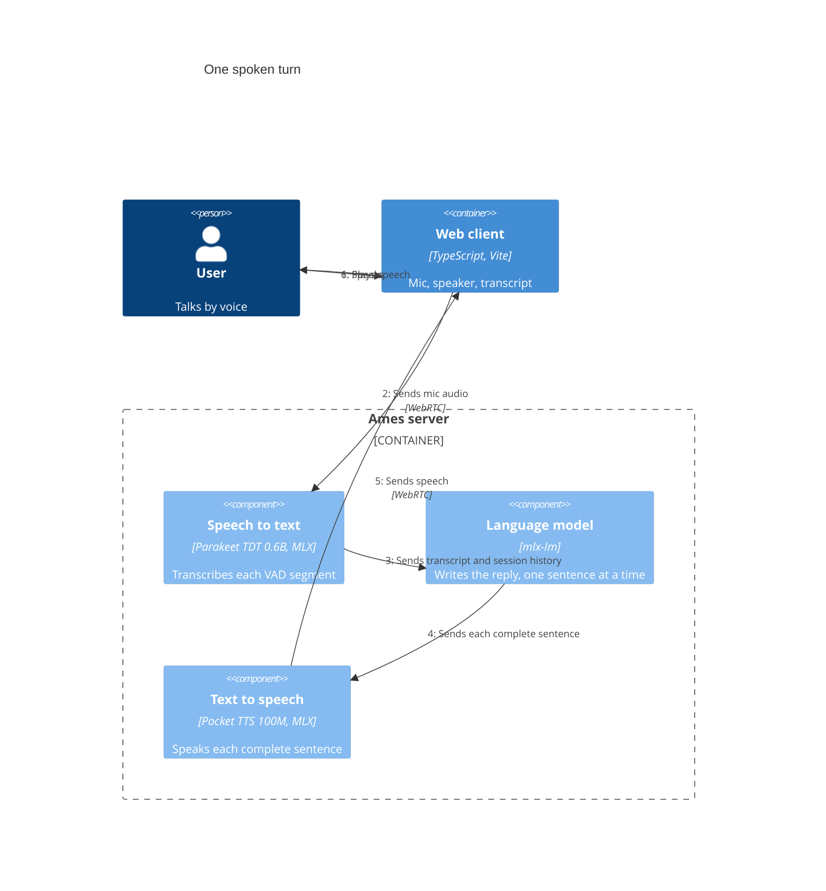

# C4 dynamic: one spoken turn

This diagram shows the order of calls for one spoken turn. Source: `server/live.py`, `server/cascade.py`, `server/tts.py`.

Notes:

- Steps 4 to 6 repeat for each sentence. Ames starts to speak after the first complete sentence, while the model writes the next one.
- If the user speaks for 300 ms or more, Ames stops and listens (see the voice pipeline component diagram).
