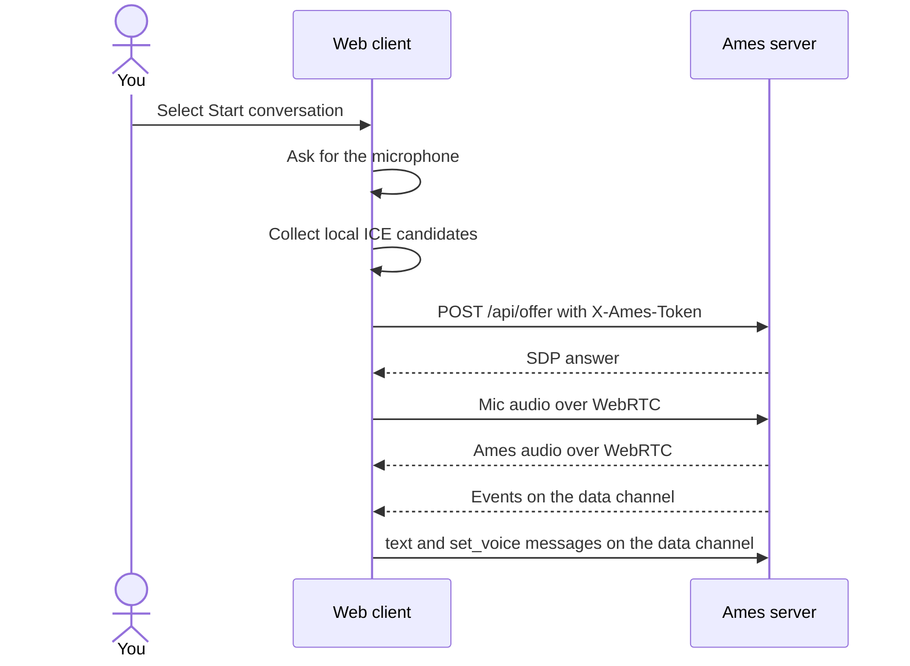

# Web client

The web client is the page that you use in Chrome. It records your microphone, plays the voice of Ames, and shows the transcript. It uses TypeScript and Vite, with no UI framework.

## Build and test

Use Node 22.18 or a later Node 22 release. Run these commands in `web/`:

```sh
npm ci
npm run lint
npm test
npm run build
npm run dev
```

## Run

1. Build the client with `npm run build`.
2. From the repository root, start the server:

   ```sh
   AMES_STUB=1 uv run --locked python -m server.app
   ```

3. Use the Chrome tab that the server opens at `http://127.0.0.1:8765`.

Port 5173 (`npm run dev`) serves only the Vite development page. Sessions need the token, so they run only from the built page on port 8765.

## Source files

| File | Job |
|---|---|
| `src/main.ts` | Supplies the token. Closes the session when the page closes. |
| `src/auth.ts` | Moves the token from the URL into `sessionStorage`. |
| `src/rtc.ts` | Opens the WebRTC connection. Checks each server event and routes it. |
| `src/ui.ts` | Updates the HTML controls. |
| `server/events.py` | Defines the server event payloads (in the server, not in `web/`). |

All assets are bundled locally. The page loads no CDN assets and no remote fonts.

## Token and first-run advisory

1. The server opens the page with `#t=<token>` in the URL.
2. The client moves the token into `sessionStorage` and removes it from the address bar.
3. The client sends the token only in the `X-Ames-Token` header. It never puts the token in a query string or in the offer body.

You must accept the first-run advisory before you start a conversation. The client keeps the acceptance in `localStorage`. If you clear site data, the advisory shows again. If storage is not available, the acceptance lasts for that visit only.

## Session flow



The microphone request turns on echo cancellation, noise suppression, and automatic gain control. `peerConfiguration()` gives an empty `iceServers` list, so the connection uses no STUN or TURN server. If Chrome blocks autoplay, the audio element shows its native controls.

In stub mode, the reply is a tone that goes through the live pipeline.

## Controls

| Control | Behavior |
|---|---|
| Orb | Shows who is speaking, from the `speaking` event. It has a text label and supports reduced motion. |
| Transcript | Updates each turn in place until its final event. Stays after **End session**. Clears when a new conversation starts. |
| **Mute microphone** | Turns off the outgoing audio track. Incoming audio continues to play. Sends no HTTP request. |
| **End session** | Closes the local peer and releases the microphone, also during connection setup. Sends no HTTP request. |
| Text box and **Send** | Enabled while a session is connected, muted or not. Enter or **Send** sends `{"type": "text", "text": "..."}` on the data channel and clears the box. The server treats the text as a spoken turn and stops any reply in progress. |
| **Web search** switch | Off by default. Reads and sets `/api/search` with the token header. A `search` event shows a notice while a query runs. |
| **Saved memories** panel | Loads `/api/memories` when you open it. Deletes a memory with `DELETE /api/memories/{id}`. |
| **Female voice** and **Male voice** | Work before and during a session. The choice is kept in `localStorage`. The client sends `set_voice` when a session connects and when the choice changes. |

The page shows transcript and notice content as plain text, never as HTML.

## Notices and errors

| Event or condition | What the page does |
|---|---|
| `session_replaced` or `session_ended` | Closes the session. Keeps the notice on screen until you start a new conversation. |
| `server_error` | Shows the server text. The session stays open. |
| Microphone permission denied | Shows how to allow the microphone in Chrome. |
| Connection lost | Offers **Reconnect**. It does not promise that memory is kept. |
| Temporary WebRTC disconnection | The connection can recover. A server error notice stays visible after a later connection loss. |

Late events from a closed session cannot replace a terminal notice. They cannot update a new session.

## Tests

The tests use the Node test runner, with LinkeDOM for component tests. They need no browser, microphone, GPU, network, or downloaded models.

Run the component acceptance tests:

```sh
node --experimental-strip-types --test tests/ui.test.mjs
```

## Manual checks

The maintainer does these checks in Chrome:

- First-run acceptance.
- Microphone permission denial and recovery.
- Real audio playback and mute.
- **End session** during setup.
- Connection loss and reconnect.
- Keyboard navigation.
- Reduced motion.
- Layout in a narrow window.
- A second session, to see the replacement notice.
